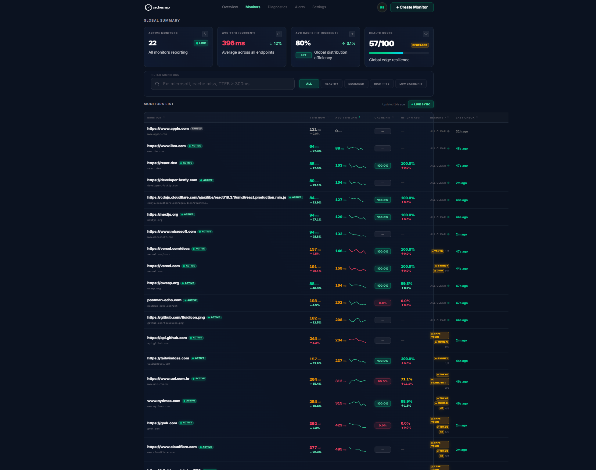
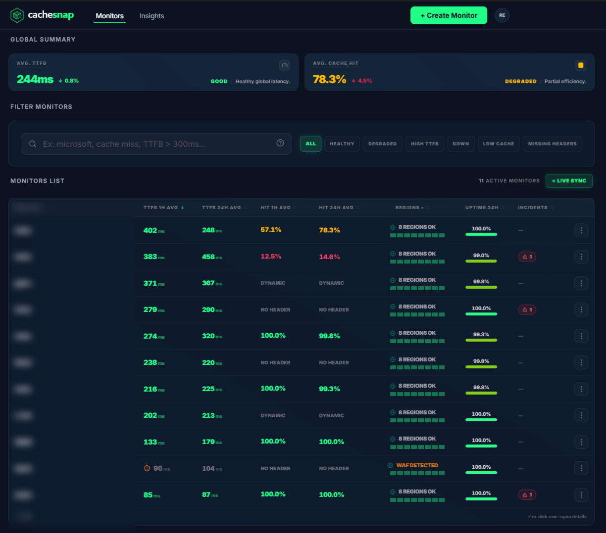
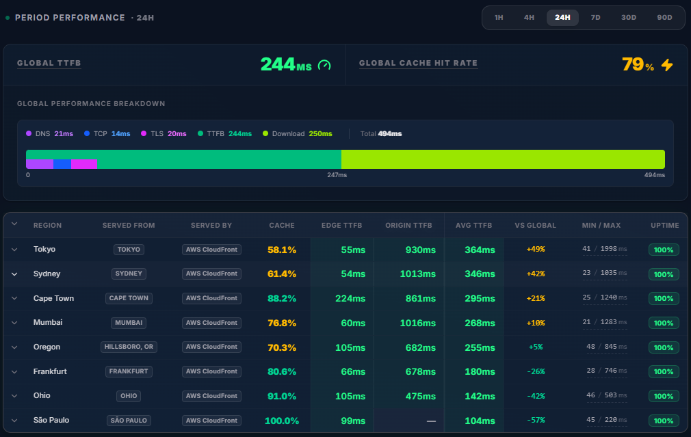
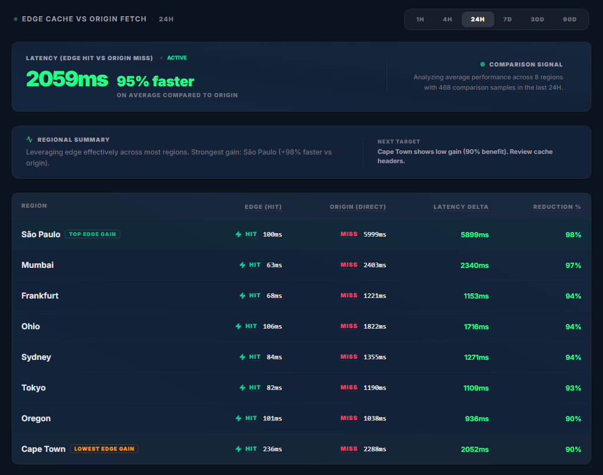
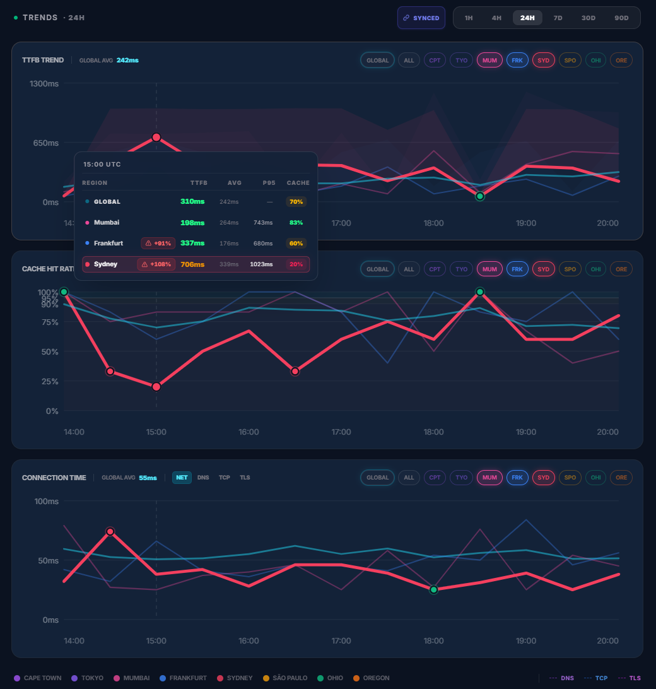

# CacheSnap

> **Edge & CDN performance monitoring that explains *why* a site is slow — in plain English.**


-lightgrey)

CacheSnap was a SaaS I designed and built end to end — backend, frontend, infrastructure and billing — and ran in production with live payments until **September 2026**, when I shut it down for lack of customers. The code is published here as a portfolio piece. It is complete and was production-grade, but **it is no longer maintained and the hosted service is offline**.



---

## What it did

Paste any public HTTPS URL, pick regions, and CacheSnap probes it from up to **8 AWS regions** (São Paulo, Ohio, Oregon, Frankfurt, Tokyo, Mumbai, Sydney, Cape Town). It reads CDN/cache headers alongside timing data and turns the signals into a **diagnosis and a recommended action** — no SDK, agent or DNS change required.

- **Deterministic diagnosis engine** — 9 prioritized rules, sub-millisecond, no LLM ([write-up on dev.to](https://dev.to/rodrigoescorsim/i-skipped-the-llm-and-built-a-9-rule-deterministic-diagnosis-engine-for-my-performance-monitoring-4fni))
- **Edge vs. origin audits** — periodic cache-bypass probes compare CDN performance against the origin
- **Adaptive baselines** — rolling 7-day statistics per URL and region, so anomalies are measured against *your* normal
- **Alerting** — cache hit rate, cache age, SSL expiry, anycast routing mismatch (via `CF-Ray` parsing) and trend detection, with an incident state machine, digests and HMAC-signed snooze links (email, Slack, Discord)
- **Live dashboard** — Server-Sent Events push new probe results to the browser as they are ingested

| | |
|---|---|
|  |  |
|  |  |

---

## Architecture

```
                 ┌──────────────────────────┐
  Browser ◀─SSE──│  Rust API (axum + Tokio) │◀── ingest ──┐
     │           │  scheduler · diagnosis   │             │
     ▼           │  baselines · alerts      │── dispatch ─┼─▶ AWS Lambda probes
  Next.js 16     └─────┬──────────────┬─────┘             │   (Node.js 20, arm64,
  (dashboard,          │              │                   │    8 regions)
   auth, billing)      ▼              ▼                   │
     │          PostgreSQL /       Redis ─────────────────┘
     └────────▶ TimescaleDB     (Lua scheduling gates)
```

### Engineering highlights

- **Exactly-once scheduling across instances** — every second the scheduler asks Redis whether a monitor is due; an atomic **Lua script** acts as the gate, so running several API instances never double-dispatches a probe.
- **Bounded fan-out** — probe dispatch uses `buffer_unordered` with a **global and a per-region Tokio semaphore**, plus retry with backoff on HTTP 429.
- **Time-series storage** — probe results live in **TimescaleDB hypertables** with hourly continuous aggregates and compression policies on older chunks.
- **Versioned ingest contract** — probes authenticate with a shared secret and must match the expected probe version, so stale deployments cannot pollute data.
- **Four background workers** in the API process: scheduler, alerts, baselines and trend detection ([`api/WORKERS.md`](api/WORKERS.md)).
- **Tests** — 140+ Rust tests in the API and a Vitest suite for the web app.

---

## Stack

| Layer | Technologies |
|---|---|
| **Backend** | Rust, axum, Tokio, SQLx, deadpool-redis, reqwest (rustls), tokio-cron-scheduler, argon2, HMAC-SHA256, tracing |
| **Frontend** | Next.js 16 (App Router), React 19, TypeScript, Tailwind CSS 4, TanStack Query & Table |
| **Data** | PostgreSQL + TimescaleDB, Redis (Lua scripts) |
| **Infra** | AWS Lambda (8 regions), Docker Compose, Cloudflare CDN |
| **Integrations** | Google OAuth, Dodo Payments, Resend (email), Slack / Discord webhooks |

---

## Repository layout

```
api/            Rust API — ingest, scheduler, diagnosis, baselines, alerts, SSE
probes/lambda/  AWS Lambda probe (Node.js 20, zero dependencies)
src/            Next.js dashboard, auth, billing and app API routes
migrations/     SQL schema (TimescaleDB hypertables, aggregates, retention)
docs/           Product, architecture and operations notes
infra/          Production configuration
scripts/        Local dev and deployment helpers
```

Good starting points: [`docs/STACK.md`](docs/STACK.md) (technical reference), [`docs/FEATURES.md`](docs/FEATURES.md) (feature catalog) and [`api/WORKERS.md`](api/WORKERS.md).

---

## Running locally

Requirements: Node.js 20+, a Rust toolchain and Docker.

```bash
cp .env.example .env          # fill in local values
./scripts/dev.sh              # PostgreSQL/TimescaleDB + Redis via Docker
cd api && cargo run           # Rust API on :3001
npm install && npm run dev    # dashboard on :3000
```

Probes need a publicly reachable API URL and deployed Lambda functions (see [`probes/lambda/README.md`](probes/lambda/README.md)); without them the dashboard runs but no new data is collected.

```bash
cd api && cargo test          # Rust tests
npm run lint && npm test      # web app checks
```

---

## Author

**Rodrigo Maia Escorsim** — Senior Software Engineer (C++ · Rust)
[LinkedIn](https://linkedin.com/in/rodrigoescorsin) · [GitHub](https://github.com/rodrigoescorsim)
