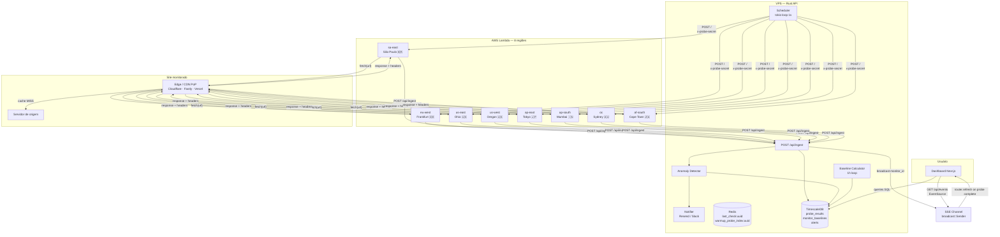
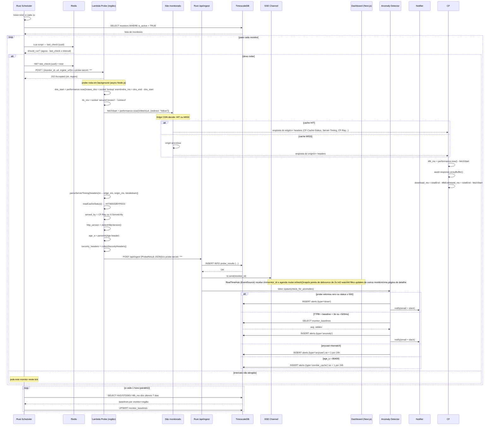
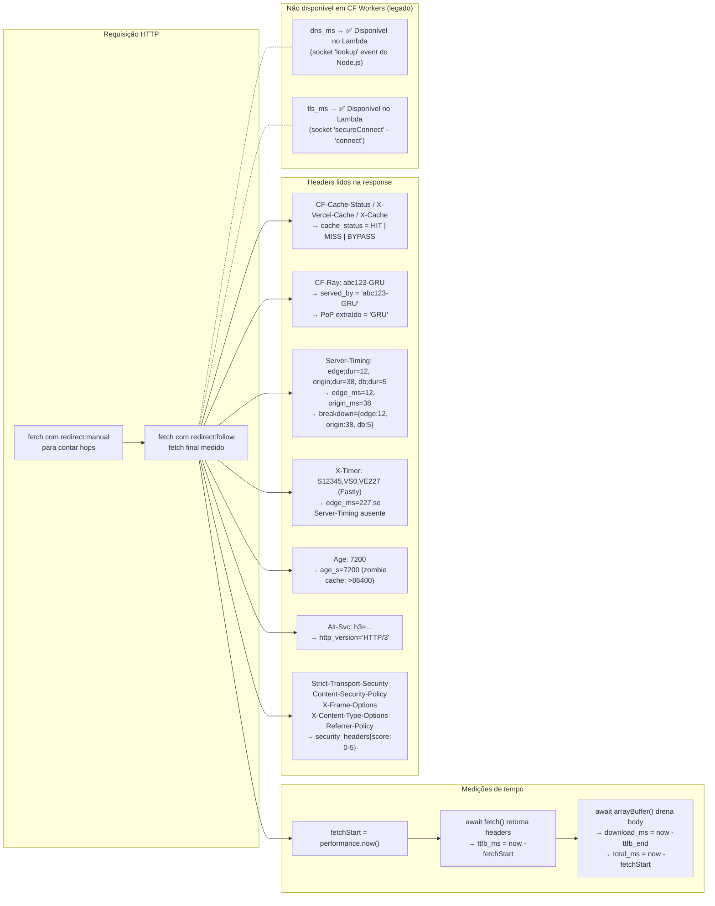
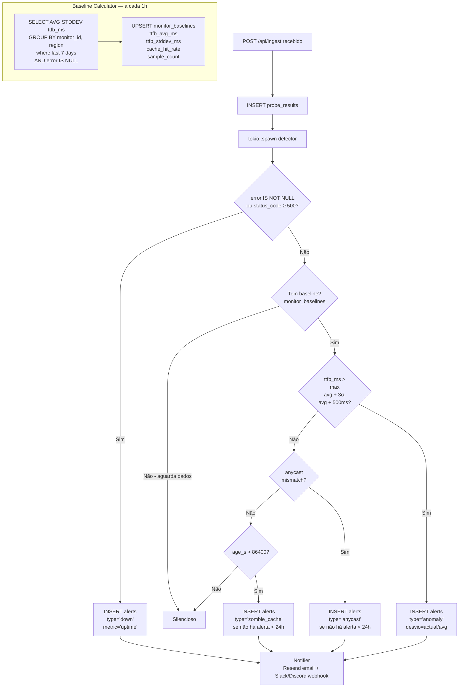
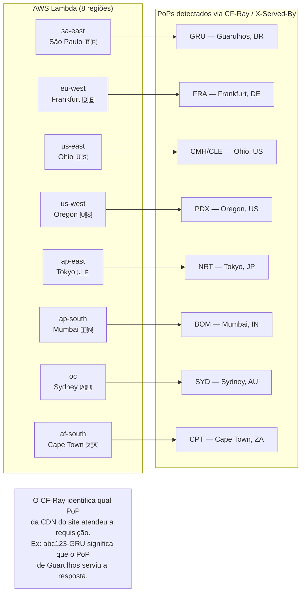
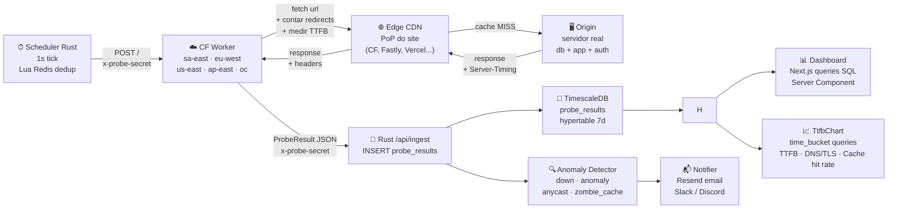

# CacheSnap — Arquitetura de Probe: do Disparo ao Dashboard

> Diagramas de sequência e fluxo de **tudo** que acontece entre o scheduler disparar um probe
> e o dado aparecer no dashboard — com os pontos exatos de captura de cada métrica.

---

## 1. Visão geral do sistema (componentes)



---

## 2. Warmup Burst — primeiras probes aceleradas

Ao criar um monitor, as 3 primeiras probes usam intervalos reduzidos para que o
usuário veja gráficos e médias (que requerem ≥ 2 amostras) logo nos primeiros 90
segundos, independente do `check_interval_seconds` configurado.

### Cadência

| Probe | Offset acumulado | Gap usado |
|-------|-----------------|-----------|
| 1 | t = 0 s | imediata (via `/dispatch` na criação) |
| 2 | t = 60 s | `warmup_probe_index = 0` → gap 60s |
| 3 | t = 120 s | `warmup_probe_index = 1` → gap 60s |
| 4+ | t = 120 s + `interval` | cadência normal |

**Regra de aceleração exclusiva:** o gap de warmup só é aplicado se for **menor**
que `check_interval_seconds`. Monitores com intervalo ≤ 60s não são afetados.

### Estado Redis

| Chave | Valor | TTL | Descrição |
|-------|-------|-----|-----------|
| `last_check:{monitor_id}` | timestamp UNIX | sem TTL | Última probe despachada pelo scheduler |
| `warmup_probe_index:{monitor_id}` | `0`, `1` ou `2` | 300s | Contador de warmup; ausente ou ≥ 2 = cadência normal |

O `warmup_probe_index` é setado como `0` pelo endpoint `POST /api/monitors/:id/dispatch`
na criação do monitor (flag `is_manual = false`). O Lua script em `should_run_now`
incrementa e renova o TTL (300s) a cada probe de warmup, funcionando como fallback
caso o endpoint de dispatch não seja chamado.

### Sequência de criação com warmup

```
Next.js API                  Rust /dispatch            Redis                 Scheduler
─────────────────────────────────────────────────────────────────────────────────────────
POST /api/monitors           →  SET last_check = now   last_check = t0
(monitor criado)             →  SET warmup_index = 0   warmup_index = 0
                             →  spawn dispatch_probes  (probe 1 disparada)

                                                                          tick t+1s:
                                                                          should_run_now?
                                                                          (now-last_check)=1s
                                                                          gap=30s → NÃO

                                                                          tick t+60s:
                                                                          (now-last_check)=60s
                                                                          gap=60s → SIM
                             SET last_check = t+60s   last_check = t60   (probe 2 disparada)
                             INCR + EXPIRE warmup_index  warmup_index = 1

                                                                          tick t+120s:
                                                                          (now-last_check)=60s
                                                                          gap=60s → SIM
                             SET last_check = t+120s  last_check = t120  (probe 3 disparada)
                             INCR + EXPIRE warmup_index  warmup_index = 2

                                                                          tick t+120s+interval:
                                                                          gap = interval → SIM
                                                                          (cadência normal)
```

---

## 3. Ciclo completo de um probe (sequência)

> Um ciclo a cada `check_interval_seconds` por monitor (padrão: 300s).



---

## 3. O que o Worker captura e de onde



---

## 4. Caminho da requisição na rede

> O que acontece entre o Worker fazer `fetch(url)` e a resposta chegar.

```mermaid
sequenceDiagram
    participant W as CF Worker\n(ex: sa-east / GRU)
    participant E as Edge PoP\n(CDN do site)
    participant O as Origin Server

    W->>E: GET https://site.com HTTP/2\n+ User-Agent CacheSnap

    alt Cache HIT
        E-->>W: 200 OK\nCF-Cache-Status: HIT\nCF-Ray: abc123-GRU\nAge: 120\nServer-Timing: cf-cache-status;desc="HIT"\nHsts, CSP, ...
        Note over W: ttfb_ms medido aqui ↑
        Note over W: download_ms: body drenado
        Note over W: edge_ms = dur do Server-Timing\norigin_ms = null (não tocou origin)

    else Cache MISS
        E->>O: Faz request ao origin
        O->>O: Processa (db, auth, app...)
        O-->>E: 200 OK + Server-Timing: db;dur=12, app;dur=38
        E-->>W: 200 OK\nCF-Cache-Status: MISS\nServer-Timing: edge;dur=5, origin;dur=50\nCF-Ray: abc123-GRU

        Note over W: ttfb_ms = edge + origem\nedge_ms = 5ms\norigin_ms = 50ms
    end

    W->>W: Monta ProbeResult completo
    W->>API: POST /api/ingest
```

---

## 5. Decomposição de tempo por probe

> Como os campos de tempo se relacionam graficamente.

```
Linha do tempo de um probe (cache MISS com Server-Timing):

t=0ms ─────────────────────────────────────────────────── t=total_ms
│                                                                    │
│  [── edge_ms ──][────── origin_ms ──────]                         │
│  [────────────── ttfb_ms ──────────────][── download_ms ──]       │
│                                                                    │
0           10          20          50          60          65ms

Exemplo concreto:
  ttfb_ms     = 55ms  ← tempo até receber os headers (edge + origin)
  download_ms = 10ms  ← drenar o body HTML
  total_ms    = 65ms  ← tudo junto
  edge_ms     =  5ms  ← tempo no PoP do CDN (do Server-Timing)
  origin_ms   = 50ms  ← tempo no servidor de origem (do Server-Timing)
  dns_ms      = null  ← não disponível em CF Workers
  tls_ms      = null  ← não disponível em CF Workers

Cache HIT (sem origin_ms):
  ttfb_ms     = 12ms  ← resposta direto do cache edge
  edge_ms     = 10ms  ← tempo no PoP
  origin_ms   = null  ← cache serviu, origin não foi acionado
  download_ms =  5ms
  total_ms    = 17ms
```

### Breakdown do Server-Timing (quando disponível)

> Servidores bem instrumentados expõem `Server-Timing` granular.
> CacheSnap armazena todo o breakdown em `server_timing_breakdown JSONB`.

```
Exemplo de Server-Timing real (Next.js + Vercel):
  Server-Timing: db;dur=12.4, auth;dur=3.1, cache;dur=0.8, app;dur=38.2

Capturado como:
  server_timing_breakdown = {
    "db":    12.4,
    "auth":   3.1,
    "cache":  0.8,
    "app":   38.2
  }
  origin_ms = 38.2   ← maior entrada com nome "app" ou "server"
  edge_ms   = 0.8    ← entrada com nome "cache"
```

---

## 6. Pipeline de análise pós-ingest



---

## 7. Dados armazenados por probe — tabela completa

| Campo | Tipo | Origem | Disponível? |
|---|---|---|---|
| `ttfb_ms` | float | `performance.now()` após `await fetch()` | ✅ Sempre |
| `download_ms` | float | `performance.now()` após `arrayBuffer()` − ttfb_end | ✅ Sempre |
| `total_ms` | float | `totalEnd - fetchStart` | ✅ Sempre |
| `dns_ms` | float | Socket `lookup` event do Node.js (Lambda) | ✅ Sempre (no Lambda) |
| `tls_ms` | float | Socket `secureConnect` - `connect` event (Lambda) | ✅ Sempre (no Lambda) |
| `edge_ms` | float | `Server-Timing` — entrada com nome edge/cdn/cache | ⚠️ Se site expõe |
| `origin_ms` | float | `Server-Timing` — entrada com nome origin/app/server | ⚠️ Se site expõe |
| `status_code` | int | `response.status` | ✅ Sempre |
| `cache_status` | string | `CF-Cache-Status` / `X-Vercel-Cache` / `X-Cache` | ⚠️ Se CDN responde |
| `served_by` | string | `CF-Ray` (código IATA) ou `X-Served-By` | ⚠️ Se Cloudflare/Fastly |
| `http_version` | string | `CF-Ray` presente → H2, `Alt-Svc: h3` → H3 | ⚠️ Heurística |
| `redirect_count` | int | Fetch manual com `redirect: "manual"` | ✅ Sempre |
| `content_length` | int | `arrayBuffer().byteLength` | ✅ Sempre |
| `age_s` | int | Header `Age` | ⚠️ Se CDN envia |
| `security_headers` | JSONB | 5 headers: HSTS, CSP, X-Frame, X-Content-Type, Referrer | ✅ Sempre (score 0-5) |
| `server_timing_breakdown` | JSONB | Todos os entries `name;dur=N` do Server-Timing | ⚠️ Se site expõe |
| `region` | string | Variável `REGION` do ambiente do Worker | ✅ Sempre |
| `error` | string | `catch(err)` — timeout, DNS fail, etc. | ⚠️ Só em falha |

---

## 8. Mapa de regiões e PoPs



---

## 9. É possível mostrar o waterfall visualmente no monitor?

**Sim.** Os dados já estão todos capturados. O que falta é a visualização.

### O que se pode exibir hoje (dados existentes)

```
Probe de stripe.com — São Paulo — 2026-04-08 14:32:01
─────────────────────────────────────────────────────────────────────────────

Fase              │ 0ms    10ms   20ms   30ms   40ms   50ms   60ms   65ms
──────────────────┼──────────────────────────────────────────────────────────
Edge (CDN PoP)    │ ████   12ms
Origin (servidor) │        ████████████████████████████   38ms
──────────────────┼──────────────────────────────────────────────────────────
TTFB              │ ██████████████████████████████████████   50ms
Download (body)   │                                     ██████   15ms
TOTAL             │ ██████████████████████████████████████████████   65ms
──────────────────┼──────────────────────────────────────────────────────────

Cache: MISS  │  PoP: GRU  │  Hops: 1  │  HTTP/2  │  Security: 4/5
Age: —  │  Content: 42.3 KB

Server-Timing breakdown:
  db    ████ 12ms
  auth  ██ 5ms
  app   ████████████████████ 38ms
```

### Comparação das 5 regiões (waterfall compacto por linha)

```
Região        TTFB    │ Waterfall (0────────────────100ms)  │ Cache  PoP
──────────────────────┼──────────────────────────────────────┼──────────────
São Paulo     38ms    │ ████████████████                     │ HIT    GRU
Frankfurt     41ms    │ █████████████████                    │ HIT    FRA
New York      44ms    │ ██████████████████                   │ HIT    IAD
Tokyo         89ms    │ ██████████████████████████████████   │ MISS   NRT ⚠️
Sydney        94ms    │ ███████████████████████████████████  │ HIT    SYD
```

### O que ainda NÃO se pode exibir (limitação de plataforma)

| Fase | Status | Motivo |
|---|---|---|
| DNS lookup | ❌ Não disponível | CF Workers usa pool global, sem acesso ao timing de DNS |
| TLS handshake | ❌ Não disponível | TLS ocorre antes do código do Worker |
| TCP connect | ❌ Não disponível | Mesmo motivo |
| DNS → TLS → TTFB completo | 🔲 Fase 2 | Exige probes Node.js no Fly.io (acesso à `net.connect()`) |

### Implementação recomendada

A visualização seria uma nova seção na **aba Performance** do monitor detail,
renderizada em SVG puro (como o TTFB timeline já existente), usando os campos
`ttfb_ms`, `download_ms`, `edge_ms`, `origin_ms`, `server_timing_breakdown`,
`cache_status`, `served_by`, `redirect_count` e `age_s` de um probe específico.

**Dados de entrada:** último probe por região (ou probe selecionado por timestamp).

**Output:** barra de waterfall horizontal por região + breakdown do Server-Timing
quando disponível.

---

## 10. Fluxo completo resumido (uma linha por etapa)



---

## 6. Gráficos de série temporal

Os dados armazenados em `probe_results` são agregados por `time_bucket` e visualizados como gráficos SVG inline no componente `TtfbChart` (`src/app/dashboard/monitors/[id]/ttfb-chart.tsx`).

| Gráfico | Métrica | Granularidade 24h | Granularidade 7d | Tipo de linha |
|---------|---------|------------------|-----------------|---------------|
| Main Speed | `AVG(ttfb_ms)` por região | 30 min | 6 h | Sólida, cor por região |
| Network Phase | `AVG(dns_ms + tls_ms)` global | 30 min | 6 h | Tracejada (DNS=roxo, TLS=fuchsia) |
| Cache hit rate | `COUNT HIT / COUNT *` por região | 30 min | 6 h | Sólida, cor por região; escala 0-100% |

O componente renderiza apenas a partir de 2+ buckets. Com menos dados exibe "Analyzing historical patterns...".

Os helpers puros de cálculo (`formatChartLabel`, `niceMax`, `globalBucketAverage`) estão em `ttfb-chart.helpers.ts` e cobertos por testes unitários em `ttfb-chart.test.ts`.

---

*Documento atualizado em 2026-04-10. Reflete a migração de Cloudflare Workers para AWS Lambda (8 regiões), SSE real-time e gráficos de série temporal.*
*Baseado no código real de `probes/lambda/index.mjs`, `api/src/routes/ingest.rs`, `api/src/alerts/detector.rs` e `api/src/scheduler/runner.rs`.*
